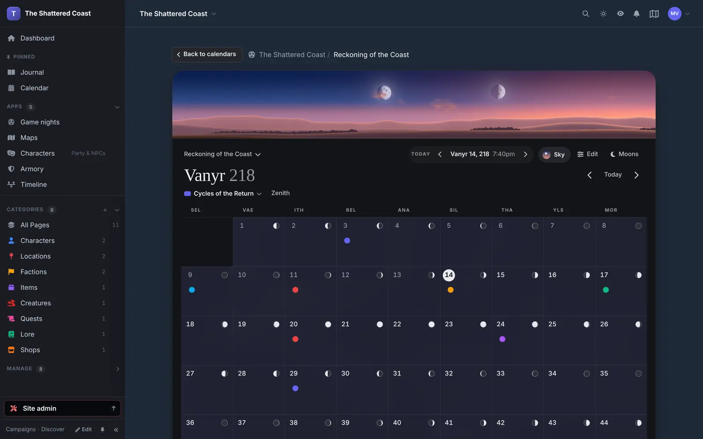
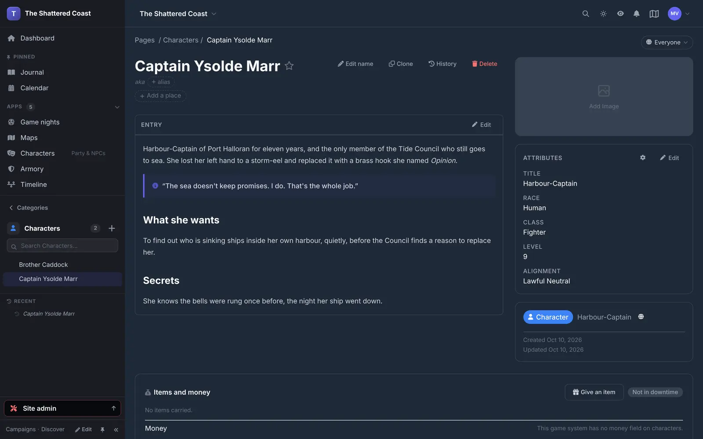
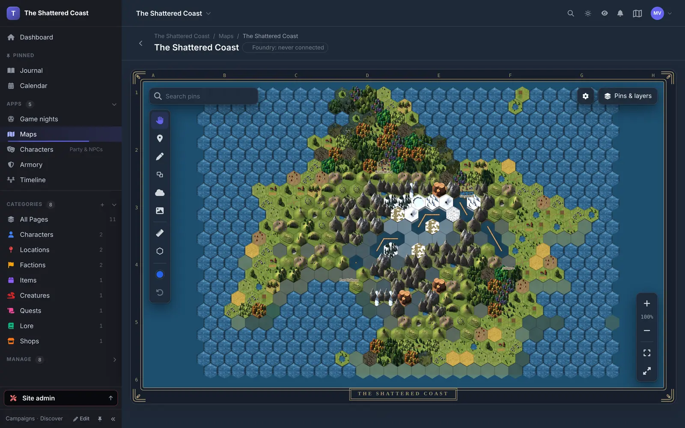
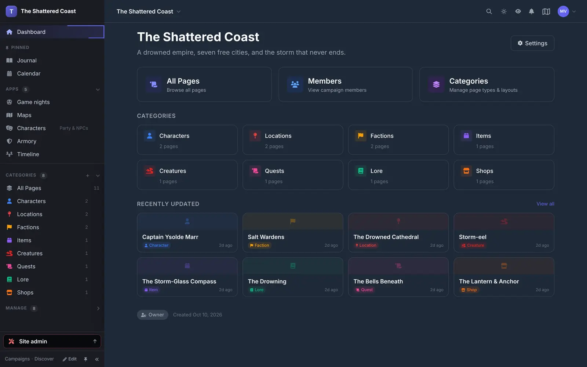
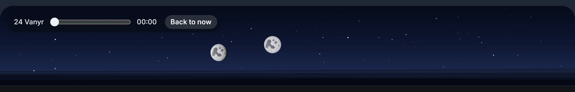
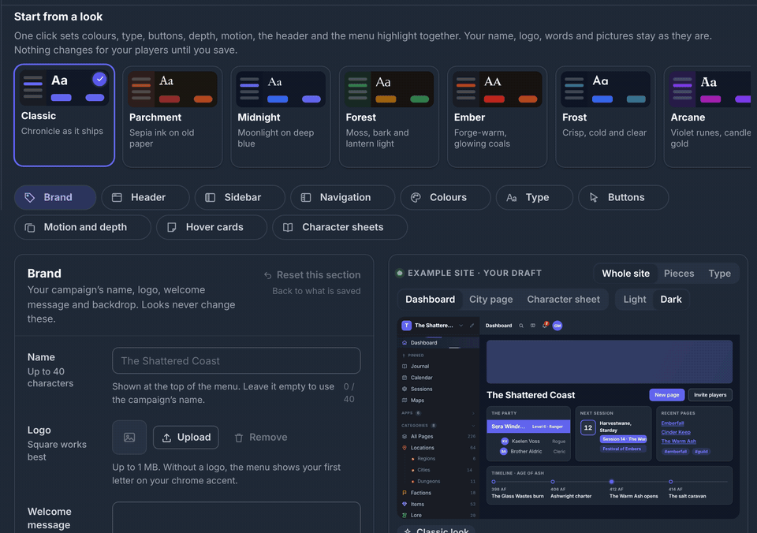

<h1 align="center">Chronicle</h1>

<p align="center">
  <b>A self-hosted home for your tabletop RPG world.</b><br>
  Lore, calendars, maps, shops and game nights for the GM and the players, on your own server.
</p>

<p align="center">
  <a href="LICENSE"></a>
  
  
</p>



Chronicle is built for one table and one world at a time. Nothing is public unless you make it public, there is no paywall, and the data lives in your own MariaDB.

<table>
  <tr>
    <td width="50%" valign="top">
      <br>
      <b>Pages for everything in your world</b><br>
      Characters, places, factions, items and quests, each with a rich-text entry, its own fields and links to the pages it touches. GM secrets stay hidden inside the same page.
    </td>
    <td width="50%" valign="top">
      <br>
      <b>Maps you paint and annotate</b><br>
      Upload a picture or paint terrain hex by hex. Pins open pages or other maps, fog hides what the party hasn't explored, and rooms, arrows and speech bubbles turn any map into a diagram.
    </td>
  </tr>
  <tr>
    <td width="50%" valign="top">
      <br>
      <b>A rulebook your players can read</b><br>
      A game system's rules open as a book you turn the pages of, with a players' screen for lookups mid-fight. Rules terms explain themselves on hover, and you can add house-rule chapters of your own.
    </td>
    <td width="50%" valign="top">
      <br>
      <b>A campaign home</b><br>
      The dashboard, sidebar and categories are yours to arrange. Members join as Owner, Scribe or Player, and "View as player" shows the campaign exactly as they see it.
    </td>
  </tr>
</table>

### A calendar with a sky

Your own months, weekdays, moons, seasons and eras, or the real-world calendar. Events repeat by rule, weather follows the climate, pages can keep a version for each era, and the sky over the month shows the sun and moons at the hour it is.



### Make it look like your world

Customize keeps the campaign's look, categories and home pages in one place. Start from one of eight whole looks, then change colours, type, buttons, the header and the sidebar. Everything waits in a draft until you save it, so players never see a half-finished change.



### And the rest

- **Game nights**: plan sessions on the calendar, run a date poll, see who's free, and collect RSVPs. The dashboard's Coming up card shows what's next.
- **DM Screen**: the party, the world's date and weather, conditions, NPC reveals, waiting shop and stash requests, and an Adventures tab for the DM team's own pages.
- **Armory, shops and stashes**: item galleries, a walk-in shop room players buy from, and shared party hoards with GM-approved moves.
- **Notes**: notes on any page, private or shared with the GM or chosen players, with version history. Every page keeps its history, and deleted pages wait in Trash.
- **Timeline**: a zoomable timeline of events, grouped into lanes.
- **Bring your world in**: import an Obsidian vault or a Notion or Trilium export, or hand the campaign to an AI tool as markdown and review its edits before they land.
- **Foundry VTT**: the [Chronicle Sync module](https://github.com/keyxmakerx/Chronicle-Foundry-Module) keeps journals, characters, maps, shops and the calendar in step both ways.
- **Game systems**: [Draw Steel](https://github.com/keyxmakerx/Chronicle-Draw-Steel) and [D&D 5e](https://github.com/keyxmakerx/Chronicle-DnD-5.5e) install from Admin > Packages.
- **Sign-in**: two-factor codes, one outside OpenID Connect provider, and guest codes that let someone join one campaign with just a name.
- **REST API**: per-campaign keys for pages, maps, calendar, media and sync. See [`docs/api/openapi.yaml`](docs/api/openapi.yaml).

## Quick start

With Docker:

```bash
git clone https://github.com/keyxmakerx/chronicle.git
cd chronicle

export SECRET_KEY=$(openssl rand -base64 32)
export DB_PASSWORD=your-secure-password
export MYSQL_ROOT_PASSWORD=your-root-password

docker compose up -d
```

Chronicle is then at http://localhost:8080. The first person to register becomes the site admin. Migrations run on startup.

For production, backups, upgrades and rollback, read [`docs/deployment.md`](docs/deployment.md).

<details>
<summary><b>Run from source</b></summary>

Needs Go 1.27+, MariaDB 10.11+ and Redis 7+ (Node.js only to rebuild the editor bundle).

```bash
git clone https://github.com/keyxmakerx/chronicle.git
cd chronicle
cp .env.example .env    # add your database credentials
make docker-up          # MariaDB + Redis
make generate           # Templ + Tailwind
make dev                # hot reload
```

</details>

## Development

```bash
make help        # every command
make dev         # dev server with hot reload
make test        # all tests
make lint        # golangci-lint
make generate    # regenerate Templ and Tailwind
```

Chronicle is a Go server (Echo, Templ, HTMX) with MariaDB and Redis. Features live in plugins under `internal/plugins/`, game systems install as packages, and reusable UI blocks are widgets under `internal/widgets/`. [`.ai/architecture.md`](.ai/architecture.md) has the full picture.

| Layer | Technology |
|-------|-----------|
| Backend | Go 1.27, [Echo v4](https://echo.labstack.com/) |
| Templates | [Templ](https://templ.guide/) |
| Frontend | [HTMX](https://htmx.org/), [Alpine.js](https://alpinejs.dev/), [Tailwind CSS](https://tailwindcss.com/) |
| Editor | [TipTap](https://tiptap.dev/) |
| Maps and timeline | [Leaflet](https://leafletjs.com/), [D3](https://d3js.org/) |
| Data | MariaDB 10.11, Redis 7 |

To build your own game system, widget, content pack or API app, start at [`docs/build/`](docs/build/README.md).

## Contributing

Chronicle is pre-alpha. Bug reports and ideas are welcome as [issues](https://github.com/keyxmakerx/Chronicle/issues). Setup, tests and pull request expectations are in [CONTRIBUTING.md](CONTRIBUTING.md).

We studied [World Anvil](https://www.worldanvil.com/), [Kanka](https://kanka.io/), [LegendKeeper](https://www.legendkeeper.com/) and [Obsidian](https://obsidian.md/) while building it; Chronicle's design and code are its own.

## License

[GNU Affero General Public License v3.0](LICENSE).

<sub>Screenshots are from a demo campaign running on Chronicle's own code.</sub>
